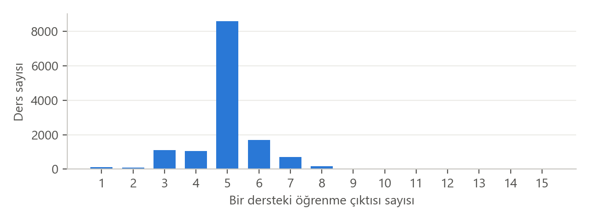
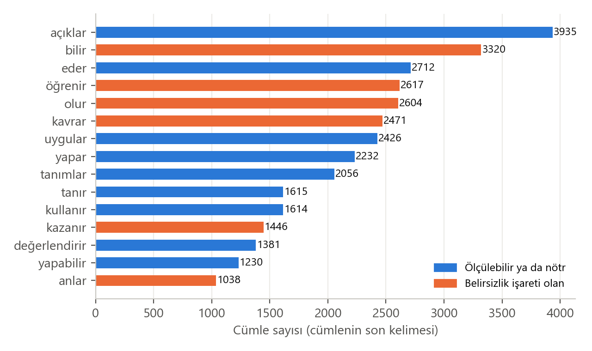
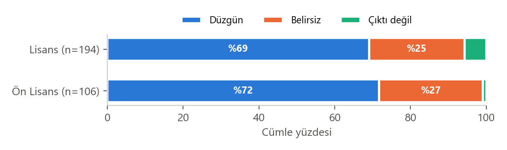
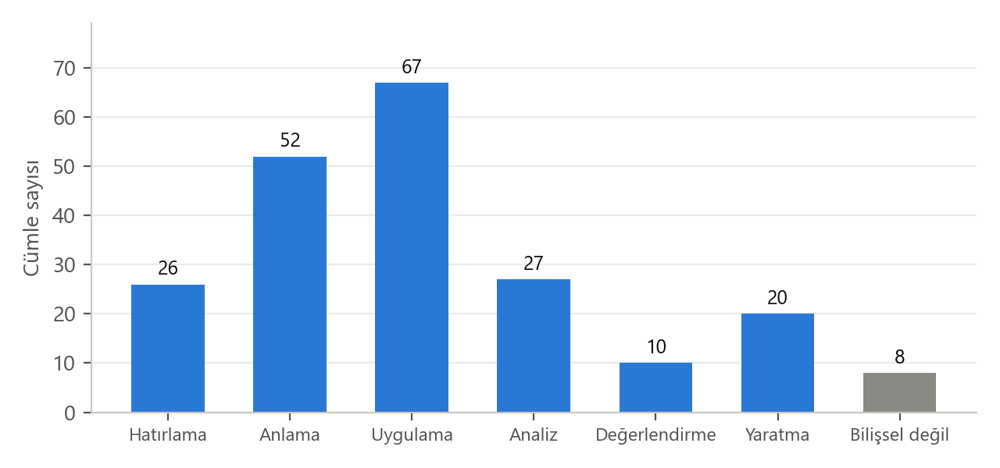
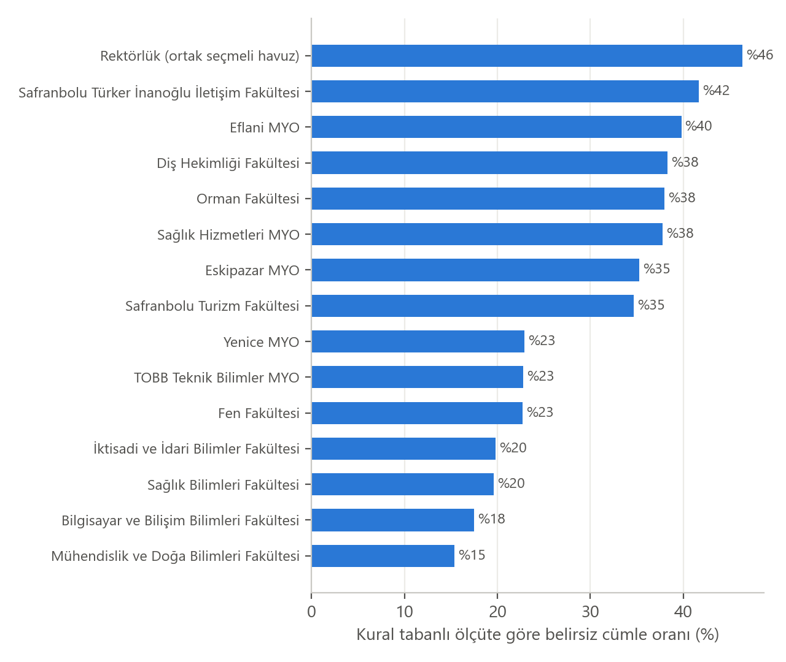

% Türkçe Ders Öğrenme Çıktılarının Yapay Zekâ ile Kalite Kontrolü: Karabük Üniversitesi Bilgi Paketi Üzerine Bir Ön Çalışma
% Alptekin Zengin
% Yapay Zekâ Dersi · Vize Raporu (Final Projesinin Birinci Aşaması) · 12 Kasım 2026

## Özet

Üniversitelerde her dersin, dersi bitiren öğrencinin neyi yapabileceğini anlatan öğrenme çıktıları vardır. Bu cümleler kalite ve akreditasyon denetimlerinde temel belge olarak kullanılır, ama bir kısmı ölçülemeyecek biçimde yazılmıştır ("bilgi sahibi olur") ya da hiç çıktı değildir ("SQL deyimleri"). Bu çalışmada, Türkçe öğrenme çıktılarını önce yazım kalitesine göre (düzgün, belirsiz, çıktı değil), sonra düzgün olanları revize Bloom taksonomisine göre sınıflayan bir sistemin ilk aşamasını sunuyorum. Karabük Üniversitesi Bilgi Paketi'ndeki 170 program biriminin ders sayfalarını yavaş bir toplama programıyla indirdim ve 14.912 ders sayfasından 69.186 öğrenme çıktısı cümlesi elde ettim. Bu cümlelerden programlara dengeli dağılmış 300 tanesini yazılı bir kural rehberine göre etiketledim: %70,0 düzgün, %26,0 belirsiz, %4,0 çıktı değil. Elle yazdığım fiil kuralı bu örnekte sınıf ortalamalı F1 0,80 değerine ulaştı; ama kuralı aynı cümlelere bakarak kurduğum için bu değer iyimser ve kural belirsiz cümlelerin yine yaklaşık dörtte birini kaçırıyor. Bulabildiğim kadarıyla Türkçe çıktılarda yazım kalitesini otomatik denetleyen bir çalışma yok; en yakın çalışma (Açar, 2024) yalnız Bloom basamağını sınıflıyor. Finalde aynı veri üzerinde kural tabanlı, klasik makine öğrenmesi ve BERTurk tabanlı modelleri sınıf başına başarı ile karşılaştırmayı planlıyorum.

**Anahtar kelimeler:** öğrenme çıktısı, Bloom taksonomisi, metin sınıflandırma, Türkçe doğal dil işleme, kalite güvencesi, akreditasyon

## 1. Giriş: Problem ve Amaç

### 1.1 Problem

Bologna süreci ile birlikte Türkiye'deki üniversiteler her dersin bilgilerini, öğrenme çıktıları da dahil olmak üzere, herkese açık bir "bilgi paketi" sitesinde yayımlıyor. Bir öğrenme çıktısı, dersi geçen öğrencinin dönem sonunda neyi yapabileceğini söyleyen kısa bir cümledir. İyi yazılmış bir çıktı gözlenebilir bir eylem içerir: "Yolluk ve besleyici hacmini hesaplayabilir." Bu cümlenin öğrenciye kazandırılıp kazandırılmadığını bir sınav sorusuyla kontrol edebiliriz. Aynı bilgi paketinde şu cümleler de var: "Yakın dönem Türkiye tarihi hakkında bilgi sahibi olur." ya da yalnızca "Sinyal ve sistemlerin temel kavramları." İlkinde öğrencinin ne yapacağı belli değil; ikincisi zaten bir cümle değil, bir konu başlığı.

Bu fark kâğıt üzerinde küçük görünüyor ama kalite süreçlerinde önemli. YÖKAK'ın kurumsal değerlendirmelerinde ve mühendislik programları için MÜDEK akreditasyonunda ders çıktıları program çıktılarıyla eşleştiriliyor ve ölçme araçlarının bu çıktıları gerçekten ölçüp ölçmediği soruluyor. Ölçülemeyen bir çıktı bu zincirin ilk halkasını kırıyor. Türkiye'de yapılan elle incelemeler sorunun küçük olmadığını gösteriyor: Yolcu (2019) bir mühendislik programındaki 324 kazanımın %54'ünü zayıf yapılandırılmış bulmuş, Demiröz (2025) bir yönetim bilişim sistemleri programında 476 hedefin %30'unun geçerli ölçmeye uygun olmadığını raporlamış. Benim topladığım veride de, daha ilk satırlarda, bir dersin beş çıktısının beşinin birebir aynı cümle olduğunu gördüm.

Sorun şu: bir üniversitede on binlerce çıktı cümlesi var. Karabük Üniversitesi bilgi paketinde 14.912 ders kaydı listeleniyor. Bunları her dönem elle okumak, hangi dersin düzeltilmesi gerektiğini bulmak için haftalar demek. Saule ve arkadaşları (2026) müfredat kılavuzlarına göre yapılan elle denetimin ders başına yaklaşık bir gün sürdüğünü belirtiyor (özetten).

### 1.2 Amaç

Bu projenin amacı, Türkçe ders öğrenme çıktısı cümlelerine iki soru soran bir yapay zekâ sistemi geliştirmek:

1. **Cümle düzgün yazılmış mı?** Düzgün (ölçülebilir eylem var), belirsiz ("bilgi sahibi olur", "öğrenir", "anlar", "kavrar") ya da çıktı değil (konu başlığı, yarım ifade).
2. **Düzgünse Bloom basamağı ne?** Revize Bloom taksonomisinin bilişsel basamakları (Anderson ve Krathwohl, 2001): hatırlama, anlama, uygulama, analiz, değerlendirme, yaratma. El becerisi ya da tutum anlatan düzgün cümleler "bilişsel değil" olarak ayrı işaretlenir.

Sistemin çıktısı program düzeyinde bir rapor olacak: hangi programda sorunlu cümle oranı yüksek, hangi derslerin çıktıları düzeltilmeli, basamak dağılımı dengeli mi. Sıralamayı bilerek böyle kurdum. Belirsiz bir cümlenin Bloom basamağını sormak anlamsız; "bilgi sahibi olur" hiçbir basamağa ait değil. Yolcu (2019) da elle yaptığı incelemede aynı sırayı izlemiş: önce yapıya bakmış, sonra yalnız iyi yapılandırılmış kazanımları sınıflamış.

Vize aşamasında yaptıklarım şunlar: veri setini topladım, 300 cümlelik etiketli bir örnek ve kural rehberi hazırladım, ön analizi yaptım ve literatürü taradım. Model eğitimi ve değerlendirmesi finalde yapılacak; bu raporda henüz eğitilmiş bir modelin sonucu yok.

## 2. Literatür Taraması

### 2.1 Tarama yöntemi

Taramayı dört başlıkta yaptım: (1) Bloom basamağına göre otomatik metin sınıflama, (2) ders çıktısı ile program çıktısının otomatik eşleştirilmesi, (3) müfredat ve akreditasyon belgelerinde metin analizi ve ölçülebilirlik denetimi, (4) Türkiye'deki çalışmalar. İngilizce ve Türkçe toplam 36 sorgu kullandım. Türkçe tarafta DergiPark ve YÖK Tez Merkezi'nin kendi arama arayüzleri otomatik erişime izin vermediği için, DergiPark makalelerinin büyük kısmını dizinleyen OpenAlex kataloğunda 13 ek sorgu çalıştırdım ve Google Akademik'te elle arama yaptım. Kaynakçaya yalnız sayfasını açıp künyesini doğrulayabildiğim kaynakları aldım. Sayfası açılmayan 10 kaynağı dışarıda bıraktım. Bazı çalışmalarda yalnız özete ulaşabildim; o durumlarda sayıların özetten geldiğini metinde belirttim.

### 2.2 Bloom basamağına göre otomatik sınıflama

Bu alanda çok çalışma var, ama taradıkça önemli bir ayrım fark ettim: çalışmaların çoğu öğrenme çıktısını değil, **sınav sorusunu** sınıflıyor. BloomNet (Waheed vd., 2021) başlığında "learning outcome" geçse de deneylerini 600 ve 141 açık uçlu soru üzerinde yapıyor; RoBERTa tabanlı modeliyle aynı dağılımdaki sorularda %87,5, farklı kaynaktan gelen sorularda %70,4 doğruluk elde ediyor. Bu 17 puanlık düşüş benim için bir uyarı: Karabük'te tıptan müzik bölümüne kadar çok farklı alan var ve bir alanda öğrenen modelin başka alanda zorlanması beklenir. Mohammed ve Omar (2020) da soru sınıflamada sözcük türü ağırlıklı TF-IDF ve word2vec ile SVM kullanarak ağırlıklı F1 değerini %89,7'ye çıkarmış; klasik yöntemlerin hâlâ güçlü bir taban çizgisi olduğunu gösteren bir sonuç.

Çıktı cümlelerine doğrudan bakan çalışmalar daha az. En büyük veri seti Li ve arkadaşlarına (2022) ait: Avustralya'da bir üniversitenin 21.380 öğrenme hedefi, ince ayarlı BERT ile basamak başına 0,88 ile 0,95 arasında F1. Shaikh ve arkadaşları (2021) aynı LSTM modelinin çıktı cümlelerinde yaklaşık %87, sınav maddelerinde yaklaşık %74 doğruluğa ulaştığını raporluyor (özetten). Yani çıktı cümleleri, fiil sinyali güçlü olduğu için sorulardan daha kolay sınıflanıyor. Aynı çalışmada anahtar kelime yöntemi %55 civarında kalmış; fiil listesiyle yetinmenin neden yetmediğini gösteren bir sayı.

Büyük dil modelleri konusunda sonuçlar karışık. Almatrafi ve Johri (2025) 1.000 ders çıktısında GPT-4'ü farklı istem stratejileriyle denemiş ve ince ayarlı BERT'in yine daha iyi olduğunu bulmuş (özetten). Kumar ve arkadaşları (2025) 600 cümlelik küçük bir veride veri artırmalı SVM'nin %94 ile hem BERT'i hem de büyük dil modellerini (yaklaşık 0,72) geçtiğini bildiriyor (özetten). Huber ve Niklaus (2025) ise dil modellerinin alt basamaklarda daha başarılı olduğunu, üst basamaklarda zorlandığını gösteriyor. Bu üç sonuç benim için önemli bir tasarım bilgisi: elimdeki etiketli veri küçük olacağı için BERTurk'ün her durumda en iyisi olacağını varsaymamalıyım, klasik yöntemi ciddi bir rakip olarak kurmalıyım.

İngilizce dışındaki dillerde de denemeler var. Botas ve arkadaşları (2026) Portekizce çoktan seçmeli sorularda BERT'in anahtar kelime yöntemini geçtiğini, çeviriyle elde edilen verinin ise biraz daha kötü sonuç verdiğini raporluyor.

Türkçe için bulabildiğim tek otomatik çalışma Açar'ın (2024) çalışması. Harran Üniversitesi'nin 2023 ve 2024 yıllarına ait yaklaşık 38 bin öğrenme çıktısını Word2Vec, FastText ve BERT gömmeleriyle LSTM modeline vermiş ve bilişsel, duyuşsal, psikomotor alanlardan oluşan 11 sınıfa ayırmış. Kayıt özetine göre en iyi sonuç BERT ile yaklaşık %90 doğruluk; az örnekli "yaratma" ve "değerlendirme" sınıflarında karışıklık var. Tam metne erişemediğim için ayrıntıları özetteki kadarıyla aktarıyorum. Bu çalışma benim için hem iyi hem kötü haber: Türkçe çıktıların Bloom'a göre otomatik sınıflanabildiğini gösteriyor, ama "Türkçede kimse yapmamış" diyemeyeceğim anlamına geliyor. Dikkatimi çeken bir ayrıntı daha var. Çıktı yazımı konusunda rehberlik eğitimi verildikten sonra doğruluk artmış. Bu, cümleler düzgün yazıldıkça sınıflamanın kolaylaştığını düşündürüyor. Bu benim yorumum, çalışmanın kendi sonucu değil; ama önce kaliteye bakma fikrini destekliyor.

### 2.3 Ders çıktısı ile program çıktısının eşleştirilmesi

Akreditasyonda asıl iş, ders çıktılarının program çıktılarıyla eşleştirilmesi. Zaki ve arkadaşları (2023) bu eşleştirmeyi doğal dil işleme ile otomatikleştirmiş ve iki programda uzman eşleştirmesine göre %83,1 ve %88,1 kesinlik bildirmiş (özetten). Shiferaw ve arkadaşları (2024) BERT ile %98,66 gibi çok yüksek bir değer raporluyor, ama veri ayrıntısı az olduğu için bu sayıya temkinle yaklaşıyorum. Asiri (2022) ise ABET'e sunulan 152 öz değerlendirme raporu üzerinde birliktelik kurallarıyla çalışmış ve sınıf bazında en fazla %55 başarıya ulaşabilmiş; kısa metinlerde anlamın yetersiz kalmasını sebep gösteriyor.

Bu üç çalışmanın ortak noktası, eşleştirmeye geçmeden önce çıktının kendisinin iyi yazılıp yazılmadığına bakmamaları. "SQL deyimleri" gibi bir konu başlığı da bir program çıktısıyla eşleştirilebilir, ama bu eşleştirmenin bir anlamı yok. Benim önerdiğim kalite adımı, bu sistemlerin önüne konacak bir süzgeç gibi düşünülebilir.

### 2.4 Çıktı kalitesinin denetimi

Öğrenme çıktısı kalitesini doğrudan inceleyen çalışmaların çoğu elle yapılmış. Meda ve Swart (2017) bir elektrik mühendisliği müfredatında çıktıların %9'unu belirsiz, %10'unu gözlenemez, %23'ünü ölçülemez bulmuş. Newton ve arkadaşları (2020) İngiltere'deki 35 üniversite ve ders kitabından topladıkları 47 farklı Bloom fiil listesini karşılaştırmış ve listeler arasında çok az uyum olduğunu göstermiş; ortak bir liste ve "kaçınılacak fiiller" listesi çıkarmışlar. Bu sonuç, kural tabanlı bir sistemin neden kırılgan olacağını da açıklıyor: hangi fiilin hangi basamağa ait olduğu konusunda kurumlar bile anlaşamıyor.

Büyük dil modelleriyle kalite denetimi denemeleri yeni ve sonuçları zayıf. Butt ve arkadaşları (2025) 100 öğrenme hedefini GPT ile SMART ölçütlerine göre değerlendirmiş ve uzmanlarla yalnız "ilgili olma" boyutunda makul uyum bulmuş. Fabiyi (2025) de ChatGPT'nin öğrenme çıktılarını değerlendirmedeki sınırlarını tartışıyor.

### 2.5 Türkiye'deki çalışmalar

Türkiye'de öğrenme çıktıları üzerine yapılmış çalışmaların neredeyse tamamı elle doküman analizi. Yolcu (2019) ve Demiröz (2025) yukarıda andığım oranları buldu. Özer ve Bayram (2026) bir vakıf üniversitesinin 125 mühendislik izlencesindeki 738 çıktıyı revize Bloom'a göre kodlamış; ölçülemez fiillerin ve tek çıktıda birden fazla davranışın sık görüldüğünü raporlamış. Eğitimde doğal dil işleme kullanımı Türkçe için de yeni yeni ele alınıyor: Kara ve arkadaşları (2025) Türkçe kısa cevapları BERT ile puanlamış, Aslan Yılmaz ve Deniz (2024) ölçme ve değerlendirmede doğal dil işlemenin olanaklarını Türkçe örneklerle tartışmış. Ama bu çalışmalar öğrenci cevaplarıyla ilgileniyor, çıktı cümleleriyle değil.

### 2.6 Mevcut yöntemlerin eksikleri

Taradığım çalışmaları Tablo 1'de özetledim.

Tablo 1. Yakın çalışmaların karşılaştırması

| Çalışma | Dil | Veri | Kalite sınıfı | Bloom | Yöntem ve sonuç |
|---|---|---|---|---|---|
| Waheed vd. (2021) | İngilizce | 600 + 141 soru | Yok | Var | RoBERTa, %87,5 / %70,4 |
| Li vd. (2022) | İngilizce | 21.380 çıktı | Yok | Var | BERT, F1 0,88–0,95 |
| Shaikh vd. (2021) | İngilizce | Çıktı ve soru | Yok | Var | LSTM, ~%87 (çıktı) |
| Almatrafi ve Johri (2025) | İngilizce | 1.000 çıktı | Yok | Var | GPT-4 < ince ayarlı BERT |
| Kumar vd. (2025) | İngilizce | 600 cümle | Yok | Var | SVM %94, LLM ~0,72 |
| Zaki vd. (2023) | İngilizce | 2 program | Yok | Yok | Eşleştirme, kesinlik %83–88 |
| Butt vd. (2025) | İngilizce | 100 hedef | SMART | Yok | GPT, uyum zayıf |
| Yolcu (2019) | Türkçe | 324 kazanım | Elle | Elle | Doküman analizi |
| Açar (2024) | Türkçe | ~38 bin çıktı | Yok | Var | BERT-LSTM, ~%90 |
| **Bu çalışma** | **Türkçe** | **69.186 çıktı, 170 program** | **Otomatik** | **Otomatik** | **Final: kural, klasik, BERTurk** |

Tablodan üç eksik çıkıyor. Birincisi, otomatik sınıflayıcıların hiçbiri "bu cümle kötü yazılmış" diyemiyor; her girdinin mutlaka bir basamağa ait olduğunu varsayıyor. İkincisi, kalite sorununu ölçen Türkçe çalışmalar elle ve tek bir programla sınırlı. Üçüncüsü, yöntem tartışması (küçük veride klasik yöntem mi, BERT mi, büyük dil modeli mi) Türkçe ve BERTurk için hiç sınanmamış.

## 3. Veri Seti ve Ön Analiz

### 3.1 Veri kaynağı ve toplama

Veriyi Karabük Üniversitesi Bilgi Paketi'nden (obs.karabuk.edu.tr/oibs/bologna) topladım. Sitede 108 lisans ve 62 ön lisans olmak üzere 170 program birimi listeleniyor. Her programın ders listesinde dersin yarıyılı ve kodu, her ders sayfasında da "Dersin Öğrenme Çıktıları" tablosu var. Toplama işini kendi yazdığım küçük bir Python programıyla yaptım. Program önce program listesini, sonra her programın ders listesini, en son da ders sayfalarını açıyor ve çıktı tablosundaki cümleleri hiç değiştirmeden bir CSV dosyasına yazıyor. Seçmeli ders havuzlarındaki dersleri de dahil ettim; Antrenörlük Eğitimi gibi bazı programların ders listesinin uzun olmasının sebebi bu büyük havuzlar.

Toplamaya başlamadan önce sitenin kullanım şartlarına baktım. Tarama yapılmasını yasaklayan bir kural ya da robots.txt dosyası bulamadım; bilgi paketi zaten kamuya açık olsun diye hazırlanmış bir kaynak. Yine de siteyi yormamak için program her istek arasında 2 ile 3 saniye bekliyor. Bu yüzden 14.912 ders sayfasının tamamını indirmek yaklaşık 11 saat sürdü. Dersleri rastgele sırayla indirdim; böylece toplama sürerken elimdeki her ara kopya bütün üniversiteden dengeli bir örnek gibi davrandı.

Toplanan verinin doğru olup olmadığını kontrol etmek için rastgele 20 ders seçtim, sayfalarını siteden yeniden indirdim ve cümleleri farklı bir yöntemle (HTML ayrıştırıcı ile) okuyup tablodakilerle karşılaştırdım. 20 dersin 20'sinde cümle sayısı, sırası ve metin birebir aynıydı.

Her satırda şu bilgiler var: üniversite, seviye (lisans ya da ön lisans), birim (fakülte ya da yüksekokul), program, ders kodu, ders adı, yarıyıl, çıktının sırası ve cümlenin kendisi.

### 3.2 Genel görünüm

Toplam 14.912 ders sayfası indirdim. Bunların 1.210 tanesinde çıktı tablosu boş; kalan 13.702 dersten toplam 69.186 cümle çıktı. Cümleler 29 birime ve 168 program birimine dağılıyor; 54.516 tanesi lisans, 14.670 tanesi ön lisans programlarından. 214 cümle İngilizce okutulan derslere ait ve İngilizce yazılmış; çalışmanın konusu Türkçe olduğu için bunları analizin dışında tuttum.

Bir dersin ortalama 5,0 çıktısı var, en sık görülen değer 5 (Şekil 1). Çok az ders 1 ya da 2 çıktıyla yetinmiş, bazıları ise 10'un üzerine çıkmış. Türkçe cümleler ortalama 8,1 kelime uzunluğunda; 4.271 cümle 3 kelime ya da daha kısa. Bu kısa cümlelerin önemli bir kısmının konu başlığı olduğunu etiketlerken gördüm.

### 3.3 Tekrar eden cümleler

Veride beklediğimden çok tekrar var. 68.972 Türkçe cümlenin yalnızca 32.348 tanesi birbirinden farklı. Tekrarların büyük kısmı, birçok programda aynı metinle okutulan ortak derslerden geliyor. Örneğin "Öğrenciler hedef dile karşı pozitif bir tutum geliştireceklerdir." cümlesi 246 farklı ders sayfasında aynen geçiyor. Bu tek başına bir hata değil; ama model eğitimi için önemli. Aynı cümle hem eğitim hem test kümesine düşerse model sınavda cevabı önceden görmüş olur. Bu yüzden finalde veriyi bölerken aynı cümlenin yalnızca bir kümede kalmasını sağlayacağım.

Bir de daha ilginç bir tekrar türü var: aynı dersin içinde birden fazla çıktının birebir aynı olması. 265 derste toplam 458 böyle fazladan satır buldum. Bu, büyük olasılıkla kopyala-yapıştır sırasında unutulmuş bir düzeltme ve doğrudan "düzeltilecek dersler" listesine girmesi gereken bir durum.

### 3.4 En sık fiiller

Türkçede fiil cümlenin sonunda olduğu için, her cümlenin son kelimesine bakarak kaba bir fiil dağılımı çıkardım (Şekil 2). En sık son kelime "açıklar" (3.935 cümle). Hemen arkasından "bilir" (3.320), "öğrenir" (2.617) ve "kavrar" (2.471) geliyor; bunlar, öğrencinin ne yapacağını göstermediği için kural rehberimde belirsiz saydığım fiiller. "Olur" ve "kazanır" da çoğunlukla belirsiz kalıpların sonunda görülüyor: "olur" ile biten cümlelerin %86'sında "bilgi sahibi", "farkında" gibi bir ifade, "kazanır" ile bitenlerin %63'ünde "bilgi", "beceri", "alışkanlık" gibi bir kazanım kelimesi var. Kısacası, en sık kullanılan beş son kelimenin üçü belirsizlik işareti taşıyor.

### 3.5 Etiketli örnek ve kural rehberi

Model eğitimi için etiketli veri gerekiyor. Etiketlemeye toplama sürerken başladığım için örneği o anki ara kopyadan seçtim; dersler rastgele sırayla indiği için bu kopya bütün üniversiteden dengeli bir kesit sayılır. Ara kopyadaki 6.203 cümleden İngilizce olanları ve birebir tekrarları çıkardım, kalan cümlelerden 300 tanesini her programdan sırayla birer cümle alarak seçtim. Sonuçta 300 cümle 166 farklı program biriminden ve 300 farklı dersten geliyor; 194'ü lisans, 106'sı ön lisans.

Etiketlemeden önce yazılı bir kural rehberi hazırladım. Rehber her sınıfın tanımını, gerçek örneklerini ve Türkçeye özgü zor durumları içeriyor. Bazı kararları tartışmaya açık olduğu için ayrıca kendim verdim:

- "-mek/-me" ile biten ama eylem içeren cümleler ("Patent başvuru dosyası hazırlayabilmek") düzgün sayılır; dil bilgisi eksik ama yapılacak iş belli.
- "Takip eder" belirsizdir; sınavda ölçülemez.
- "Karşılaştırır" analiz basamağındadır. Anderson ve Krathwohl (2001) karşılaştırmayı anlama basamağının altında sayıyor; ben ders çıktılarında karşılaştırmanın çoğunlukla iki şeyi parçalarına ayırıp ölçütle kıyaslamak anlamında kullanıldığını düşündüğüm için analiz saydım.
- Birden fazla ölçülebilir fiil varsa en yüksek basamak seçilir; "bilir ve uygular" gibi karma cümlelerde belirsiz kısım yok sayılır ve cümle düzgün kabul edilir.
- El becerisi ya da tutum anlatan düzgün cümleler ("32'lik değerleri çalar") "bilişsel değil" olarak işaretlenir.

İlk etiketleri yapay zekâ (Claude Sonnet) bu rehbere göre üretti; 300 cümleyi üç parçaya bölüp her parçayı ayrı bir oturuma verdim. Ardından bütün etiketleri tek tek kontrol ettim. Bu turda değiştirmem gereken bir etiket çıkmadı. Ama burada bir sınırı açıkça söylemem gerekiyor: kontrolü modelin önerisini görerek yaptım ve bu, insanın önüne konan cevaba yaslanma eğilimini artırır. Bu yüzden finalde 100 cümlelik bir alt kümeyi model tahminini görmeden yeniden etiketleyip iki etiket arasındaki uyumu (Cohen kappa) ölçeceğim. Veri dosyasında model tahmini ile benim kararım ayrı sütunlarda tutuluyor.

### 3.6 Kalite ve Bloom dağılımı

Tablo 2 etiketli örnekteki kalite dağılımını gösteriyor. Cümlelerin %70,0'ı düzgün, yaklaşık dörtte biri belirsiz. Örnek rastgele ve programlara dengeli dağıldığı için bu oranları üniversitenin geneline kaba bir tahmin olarak okuyabiliriz; parantez içindeki aralıklar %95 güven aralığı.

Tablo 2. Etiketli örnekte kalite dağılımı (n = 300)

| Sınıf | Cümle | Oran | %95 güven aralığı |
|---|---|---|---|
| Düzgün | 210 | %70,0 | %64,8–75,2 |
| Belirsiz | 78 | %26,0 | %21,0–31,0 |
| Çıktı değil | 12 | %4,0 | %1,8–6,2 |

Lisans ve ön lisans arasında belirgin bir fark görmedim (Şekil 3). Belirsiz oranı lisansta %25,3, ön lisansta %27,4. Konu başlığı türü cümleler ise neredeyse yalnızca lisans programlarında çıktı; ama bu sınıf toplam 12 cümle olduğu için bu farktan bir sonuç çıkarmıyorum.

Düzgün cümlelerin Bloom dağılımı Şekil 4'te. En kalabalık basamak uygulama (67 cümle), onu anlama (52) izliyor. Üst basamaklardan değerlendirme yalnızca 10 cümlede var. Bu dengesizlik model için de bir sorun: az örnekli sınıflar zor öğrenilir. Açar'ın (2024) çalışmasında da karışıklığın en çok "yaratma" ve "değerlendirme"de çıktığını hatırlatayım. Değerlendirme ölçütünü bu yüzden yalnız doğruluk olarak seçmeyeceğim (Bölüm 4.3).

### 3.7 Basit bir kural ne kadar iş görür?

Bir makine öğrenmesi modeline gerçekten ihtiyaç olup olmadığını görmek için önce elle bir kural yazdım. Kural cümledeki kelimelerden fiil ekiyle bitenleri ayırıyor. Hiç fiil yoksa cümle "çıktı değil". Fiillerden biri "öğren-", "kavra-", "anla-", "bil-", "edin-", "kazan-", "geliş-", "sahip ol-" gibi bir kökle başlıyorsa ya da cümlede "bilgi sahibi", "hakkında bilgi" gibi bir kalıp varsa ve yanında hesaplar, uygular, tasarlar gibi ölçülebilir bir fiil yoksa "belirsiz". Geri kalan her şey "düzgün". Bu kuralı etiketli 300 cümlede çalıştırdım (Tablo 3).

İlk denemede kural çok kötü çıktı. Sebebi kendi hatamdı: ölçülebilir fiili kelimenin içinde de arıyordum ve "kuramlarını" kelimesindeki "kur"u "kurar" fiili sanıyordum. Fiil kontrolünü kelimenin sonuna bakacak şekilde düzelttim. Bu düzeltmeyi aynı 300 cümlenin hatalarına bakarak yaptığım için aşağıdaki sayılar kuralın gerçek başarısından biraz yüksek; finalde kuralı hiç görmediği cümlelerle yeniden ölçeceğim.

Tablo 3. Kural tabanlı yöntemin karışıklık tablosu (satır: benim etiketim, sütun: kuralın tahmini)

| | Düzgün | Belirsiz | Çıktı değil |
|---|---|---|---|
| **Düzgün** | 199 | 11 | 0 |
| **Belirsiz** | 21 | 56 | 1 |
| **Çıktı değil** | 4 | 1 | 7 |

Kural %87,3 doğruluk aldı. Bu sayı tek başına yanıltıcı: cümlelerin %70'i zaten düzgün ve her şeye "düzgün" diyen bir sistem bile %70 alır. Sınıf başına bakınca düzgün sınıfında F1 0,92, belirsizde 0,77, çıktı değil sınıfında 0,70; ortalaması 0,80. Kural 78 belirsiz cümlenin 56 tanesini yakaladı, 21 tanesini düzgün sandı.

Hatalara tek tek baktığımda üç tür sorun gördüm. Birincisi, Türkçede "-me/-ma" ile biten isimler fiile benziyor: "Veri yapılarının uygulama alanlarını kavrar" cümlesindeki "uygulama" bir isim, ama kural onu "uygular" fiili gibi görüp cümleyi düzgün saydı. İkincisi, listede olmayan belirsiz kalıplar kaçıyor: "Teknik hakimiyet sağlar", "Yalıtım teknolojisindeki gelişmeleri takip eder", "Pazarın seçimine katkıda bulunur". Üçüncüsü, aynı karışıklık ters yönde de çalışıyor: "Gelişim ve öğrenme arasındaki ilişkiyi sentezler" düzgün bir çıktı, ama kural buradaki "öğrenme" ismini belirsiz bir fiil sanıp cümleyi belirsiz saydı. Bu sorunların hepsi, kelimeyi bağlamıyla birlikte okuyan bir modelin çözmesi gereken türden. Fiil listesine dayalı yaklaşımların çakışan ve beklenmedik ifadeler yüzünden yetersiz kaldığını söyleyen Shaikh ve arkadaşları (2021) ile kurumların fiil listelerinin birbirini tutmadığını gösteren Newton ve arkadaşları (2020) da aynı yöne işaret ediyor. Bu kural finalde modellerin geçmesi gereken çıta olacak.

### 3.8 Birimler arası fark

Aynı kuralı bütün Türkçe cümlelere uyguladım ve birimlere göre belirsiz oranını çıkardım (Şekil 5). Kural etiketli örnekte belirsiz oranını biraz düşük tahmin ettiği için (gerçek %26,0, kuralın tahmini %22,7) bu oranları kesin değer olarak değil, birimlerin sıralaması olarak okumak gerekiyor. En yüksek oran %46 ile Rektörlüğe bağlı ortak seçmeli ders havuzu, en düşük oran %15 ile Mühendislik ve Doğa Bilimleri Fakültesi. Aradaki fark, kuralın etiketli örnekteki sapmasından (yaklaşık 3 puan) çok daha büyük; ama birim bazında kuralın ne kadar yanıldığını ölçmediğim için bu sıralamayı final modeliyle yeniden kontrol edeceğim. Bu fark, final modelinin üniversite genelinde çalıştırılması gerektiğini gösteriyor: düzeltme ihtiyacı birimler arasında eşit dağılmıyor ve kalite birimi önceliği bu sıralamaya göre belirleyebilir.

### 3.9 Hiç doldurulmamış ders sayfaları

Veriyi toplarken bazı ders sayfalarının neredeyse bomboş olduğunu fark ettim. Örneğin Bulut Bilişim Operatörlüğü programındaki BBB223 Makine Öğrenme ve MLOps Yazılım Geliştirme dersinin sayfasında yalnızca "Kayıt Yok" yazıyor; ne öğretim elemanı, ne çıktı, ne de haftalık konu var. Kötü yazılmış bir çıktı düzeltilebilir, ama hiç girilmemiş bir çıktı kalite sürecinde tamamen görünmez kalıyor. Bu yüzden indirdiğim sayfaların kopyaları üzerinden, siteye yeniden istek göndermeden, her ders için dört şeyi kontrol ettim: sayfa tamamen boş mu, öğretim elemanı yazılmış mı, öğrenme çıktısı girilmiş mi, haftalık konular var mı (Tablo 4).

Tablo 4. Ders sayfalarının doluluğu (incelenen 14.912 ders)

| Eksik | Ders | Oran |
|---|---|---|
| Sayfa tamamen boş | 792 | %5,3 |
| Öğrenme çıktısı girilmemiş | 1.210 | %8,1 |
| Öğretim elemanı yazılmamış | 2.478 | %16,6 |
| Haftalık konular girilmemiş | 1.000 | %6,7 |

Öğrenme çıktısı girilmemiş derslerin oranı lisansta %8,4, ön lisansta %7,0. En az 100 dersi olan birimler arasında en yüksek oran %47 ile Rektörlüğe bağlı ortak seçmeli ders havuzu. Bu kontrol yapay zekâ gerektirmiyor, ama final raporunun önemli bir parçası olacak: "düzeltilecek dersler" listesinin başında, çıktısı kötü yazılmış derslerden önce hiç girilmemiş dersler yer almalı. Her dersin eksikleri ve sayfa bağlantısı ayrı bir tabloda tutuluyor.

## 4. Özgünlük, Literatür Boşluğu ve Final Planı

### 4.1 Boşluk

Bulabildiğim kadarıyla Türkçe öğrenme çıktılarında **önce yazım kalitesini denetleyen, sonra düzgün cümleleri Bloom basamağına ayıran ve bunu bütün bir üniversitenin programlarına uygulayıp düzeltilecek dersleri listeleyen** bir çalışma yok. Bunu üç gerekçeyle söylüyorum:

1. Otomatik Bloom sınıflayıcılarının hiçbirinde "kötü yazılmış çıktı" diye bir sınıf yok (Waheed vd., 2021; Li vd., 2022; Almatrafi ve Johri, 2025). Türkçe tek örnek olan Açar (2024) da her çıktıya bir sınıf atıyor. Oysa benim etiketli örneğimde cümlelerin %30,0'ı ya belirsiz ya da çıktı değil. Bu cümleler bir Bloom sınıflayıcısına verildiğinde model bir basamak uydurmak zorunda kalıyor.
2. Kalite sorununu ölçen Türkçe çalışmalar elle yapılmış ve tek programla sınırlı (Yolcu, 2019; Demiröz, 2025; Özer ve Bayram, 2026). Benim önerim, Yolcu'nun elle yaptığı iki aşamalı incelemeyi otomatik hâle getirip 170 program birimine aynı anda uygulamak.
3. Küçük etiketli veride hangi yöntemin daha iyi olduğu tartışması (Kumar vd., 2025; Almatrafi ve Johri, 2025) Türkçe ve BERTurk ile denenmemiş.

Taramamın bir sınırı var: DergiPark ve YÖK Tez Merkezi'nin kendi arama arayüzlerini otomatik olarak kullanamadım, bunun yerine OpenAlex kataloğu ve elle Google Akademik araması yaptım. Bu yüzden boşluk iddiamı "bulabildiğim kadarıyla" diye sınırlıyorum.

### 4.2 Katkı

Bu projenin finalde ortaya koyacağı şeyler:

- Bir üniversitenin bütün programlarını kapsayan, kamuya açık kaynaktan toplanmış ve yeniden üretilebilir bir Türkçe öğrenme çıktısı veri seti.
- Türkçeye özgü durumları (-mek/-me ekleri, karma fiiller, "-ebilir" yapısı) açıkça karara bağlayan yazılı bir etiket rehberi ve kaynağı ayrı tutulmuş etiketli örnek.
- Kalite ve Bloom'u tek akışta birleştiren bir sınıflandırıcı ve bunun kural tabanlı, klasik ve BERTurk sürümlerinin karşılaştırması.
- Kalite birimlerinin kullanabileceği program düzeyinde bir rapor: hiç doldurulmamış ders sayfaları, sorunlu cümle oranı, basamak dağılımı, ders içi tekrarlar ve düzeltilecek ders listesi.

### 4.3 Final için yöntem planı

Finalde dört adımı sırayla deneyeceğim. Her adım bir öncekini geçebiliyor mu diye bakacağım.

Tablo 5. Final yöntem planı

| Adım | Yöntem | Gerekçe |
|---|---|---|
| 1 | Kural tabanlı taban çizgisi (Bölüm 3.7'deki kuralın geliştirilmiş hâli) | Diğer modellerin geçmesi gereken çıta |
| 2 | TF-IDF (kelime ve harf n-gram) + doğrusal SVM ve lojistik regresyon | Küçük veride güçlü olduğu gösterilmiş (Kumar vd., 2025; Mohammed ve Omar, 2020) |
| 3 | BERTurk ince ayarı (Schweter, 2020) | Türkçe bağlamı ve ekleri anlayan önceden eğitilmiş model |
| 4 (isteğe bağlı) | Büyük dil modeline rehberle sıfır ve az örnekli sorma | Eğitim gerektirmeyen seçenek; sonuçları karışık (Almatrafi ve Johri, 2025) |

Etiketli veriyi 300'den 800 cümleye çıkarmayı planlıyorum. Önce mevcut model en az emin olduğu cümleleri seçecek, ben onları etiketleyeceğim; böylece az sayıdaki "çıktı değil" ve üst Bloom basamakları daha fazla temsil edilecek. Ayrıca, Bölüm 3.5'te söylediğim gibi, 100 cümleyi model tahminini görmeden yeniden etiketleyip kendi tutarlılığımı ölçeceğim.

Değerlendirmede ana ölçüm sınıf başına F1 değerlerinin ortalaması (macro-F1) olacak. Bunu seçmemin sebebi Bölüm 3.7'deki gözlem: doğruluk, en kalabalık sınıfı iyi tahmin eden bir modeli olduğundan iyi gösteriyor. Her model için karışıklık tablosu da çıkaracağım; özellikle analiz ile değerlendirme ve uygulama ile yaratma arasındaki karışıklığa bakacağım. Veriyi bölerken aynı cümlenin hem eğitimde hem testte bulunmasını engelleyeceğim, ayrıca bir birimi tamamen dışarıda bırakıp modelin hiç görmediği bir alanda ne yaptığını ölçeceğim. BloomNet'teki 17 puanlık düşüş, bu ikinci testin neden gerekli olduğunu gösteriyor.

Donanım açısından plan gerçekçi. BERTurk tabanlı model yaklaşık 110 milyon parametreli ve 8 GB belleği olan RTX 4060 ekran kartında, kısa cümlelerle ve küçük yığın boyutuyla birkaç dakikada ince ayar yapılabilir. Klasik yöntemler 16 GB RAM'li bilgisayarda saniyeler içinde çalışıyor. Son adımda en iyi modeli toplanan bütün cümlelere uygulayıp program düzeyindeki raporu üreteceğim. Sonuçları göstermek için küçük bir web sayfası da hazırlayacağım: bir cümle yapıştırıldığında sayfa kalite sınıfını ve Bloom basamağını, belirsizse sorunlu fiili gösterecek; bir program seçildiğinde o programın raporu açılacak.

### 4.4 Riskler

En büyük risk etiketli verinin az olması, özellikle "çıktı değil" sınıfında (300 cümlede 12). Bunu belirsizlik örneklemesiyle seçilen yeni etiketlerle ve gerekirse sınıf ağırlıklarıyla azaltacağım. İkinci risk etiketlerin tek kişiden gelmesi. Bunu yazılı rehber ve kör tekrar etiketleme ile kısmen karşılıyorum; ama ikinci bir etiketleyici olmadığı için gerçek bir kişiler arası uyum ölçemeyeceğim. Üçüncü risk Bloom'un kendisinin belirsizliği. Newton ve arkadaşlarının (2020) gösterdiği gibi kurumlar bile aynı fiili farklı basamaklara koyabiliyor. Bu yüzden kararlarımı rehberde açıkça yazdım ve sonuçları bu tanımlara bağlı olarak yorumlayacağım. Son olarak veri tek üniversiteden geliyor. Toplama programı aynı yazılım altyapısını kullanan başka üniversitelerin bilgi paketlerine de uyarlanabilir; ama bu vizenin kapsamı dışında.

## 5. Sonuç

Bu vize çalışmasında Türkçe öğrenme çıktılarındaki kalite sorununun gerçek ve ölçülebilir olduğunu gösterdim. Karabük Üniversitesi'nin bilgi paketinden topladığım verideki en sık son kelimelerin üçü belirsizlik işareti taşıyor, etiketli örnekte cümlelerin %30,0'ı ya belirsiz ya da hiç çıktı değil, ve bazı derslerde aynı çıktı birkaç kez tekrarlanıyor. Elle yazılmış bir fiil kuralı bu sorunların çoğunu yakalıyor ama Türkçenin isim-fiil karışıklığı ve listede olmayan kalıplar yüzünden belirsiz cümlelerin bir kısmını kaçırıyor. Literatürde Bloom sınıflaması için güçlü yöntemler var, Türkçede de bir örnek mevcut; ama bulabildiğim kadarıyla hiçbiri önce cümlenin düzgün olup olmadığını sormuyor. Finalde bu iki soruyu birleştiren modeli eğitip karşılaştıracak ve Karabük Üniversitesi için düzeltilecek dersleri gösteren program raporunu üreteceğim.

## Kaynakça

Açar, H. (2024). *Öğrenme çıktılarının derin öğrenme ile Bloom taksonomisi'ne göre sınıflandırılması*. Harran Üniversitesi Açık Erişim Arşivi. http://acikerisim.harran.edu.tr:8080/jspui/handle/11513/4182

Almatrafi, O., & Johri, A. (2025). Leveraging generative AI for course learning outcome categorization using Bloom's taxonomy. *Computers and Education: Artificial Intelligence, 8*, 100404. https://doi.org/10.1016/j.caeai.2025.100404

Anderson, L. W., & Krathwohl, D. R. (Eds.). (2001). *A taxonomy for learning, teaching, and assessing: A revision of Bloom's taxonomy of educational objectives* (Complete ed.). Addison Wesley Longman.

Asiri, Y. (2022). Short text mining for classifying educational objectives and outcomes. *Computer Systems Science and Engineering, 41*(1). https://doi.org/10.32604/csse.2022.020100

Aslan Yılmaz, K., & Deniz, K. Z. (2024). Natural language processing and machine learning applications for assessment and evaluation in education: Opportunities and new approaches. *Eğitimde ve Psikolojide Ölçme ve Değerlendirme Dergisi*. https://doi.org/10.21031/epod.1551568

Botas, J. F., Peixoto, A. R., & Ribeiro, E. (2026). BERT-based classification of cross-linguistic MCQs according to the Bloom taxonomy. In *15th Symposium on Languages, Applications and Technologies (SLATE 2026)* (OASIcs Vol. 144, pp. 4:1–4:17). Schloss Dagstuhl. https://doi.org/10.4230/OASIcs.SLATE.2026.4

Butt, A. A., Anwar, S., & Kardgar, A. (2025). *Work-in-progress: Evaluating course learning objectives with generative AI using SMART criteria* [Poster]. 2025 ASEE Annual Conference & Exposition. https://nemo.asee.org/public/conferences/365/papers/46865/view

Demiröz, E. (2025). Yönetim bilişim sistemleri eğitim programının "anlama odaklı tasarım" perspektifinden değerlendirilmesi. *Trakya Üniversitesi Sosyal Bilimler Dergisi, 27*(Ek Sayı), 117–140. https://doi.org/10.26468/trakyasobed.1494801

Fabiyi, S. (2025). What can ChatGPT not do in education? Evaluating its effectiveness in assessing educational learning outcomes. *Innovations in Education and Teaching International, 62*(2), 484–498. https://doi.org/10.1080/14703297.2024.2333395

Huber, T., & Niklaus, C. (2025). LLMs meet Bloom's taxonomy: A cognitive view on large language model evaluations. In *Proceedings of the 31st International Conference on Computational Linguistics (COLING 2025)* (pp. 5211–5246). Association for Computational Linguistics. https://aclanthology.org/2025.coling-main.350/

Kara, A., Avinç Kara, Z., & Yıldırım, S. (2025). Answer-based and reference-based BERT models for automatic scoring of Turkish short answers: The decisive role of task complexity. *International Journal of Assessment Tools in Education, 12*(4), 905–925. https://doi.org/10.21449/ijate.1687429

Kumar, R., Gulwani, D., & Singh, S. (2025). *Automated analysis of learning outcomes and exam questions based on Bloom's taxonomy* (arXiv:2511.10903). arXiv. https://arxiv.org/abs/2511.10903

Li, Y., Raković, M., Poh, B. X., Gašević, D., & Chen, G. (2022). Automatic classification of learning objectives based on Bloom's taxonomy. In *Proceedings of the 15th International Conference on Educational Data Mining (EDM 2022)*. https://doi.org/10.5281/zenodo.6853191

Meda, L., & Swart, A. J. (2017). Analysing learning outcomes in an electrical engineering curriculum using illustrative verbs derived from Bloom's taxonomy. *European Journal of Engineering Education*. http://hdl.handle.net/11462/1495

Mohammed, M., & Omar, N. (2020). Question classification based on Bloom's taxonomy cognitive domain using modified TF-IDF and word2vec. *PLoS ONE, 15*(3), e0230442. https://doi.org/10.1371/journal.pone.0230442

Newton, P. M., Da Silva, A., & Peters, L. G. (2020). A pragmatic master list of action verbs for Bloom's taxonomy. *Frontiers in Education, 5*. https://doi.org/10.3389/feduc.2020.00107

Özer, Ş. K., & Bayram, İ. (2026). Türkiye'deki bir vakıf üniversitesinde mühendislik ders izlencelerinin öğrenme çıktıları ve ölçme araçları açısından incelenmesi. *Çukurova Üniversitesi Eğitim Fakültesi Dergisi, 55*(1), 154–195. https://doi.org/10.14812/cuefd.1633101

Saule, E., Subramanian, K., & Bunescu, R. (2026). *Automatic classification of pedagogical materials against CS curriculum guidelines* (arXiv:2602.03962). arXiv. https://arxiv.org/abs/2602.03962

Schweter, S. (2020). *BERTurk – BERT models for Turkish* (Version 1.0.0) [Computer software]. Zenodo. https://doi.org/10.5281/zenodo.3770924

Shaikh, S., Daudpotta, S. M., & Imran, A. S. (2021). Bloom's learning outcomes' automatic classification using LSTM and pretrained word embeddings. *IEEE Access, 9*, 117887–117909. https://doi.org/10.1109/ACCESS.2021.3106443

Shiferaw, N. A., Leandre, S. H., Sinha, A., & Rout, D. (2024). *BERT-based approach for automating course articulation matrix construction with explainable AI* (arXiv:2411.14254). arXiv. https://arxiv.org/abs/2411.14254

Waheed, A., Goyal, M., Mittal, N., Gupta, D., Khanna, A., & Sharma, M. (2021). *BloomNet: A robust transformer based model for Bloom's learning outcome classification* (arXiv:2108.07249). arXiv. https://doi.org/10.48550/arXiv.2108.07249

Yolcu, H. H. (2019). Malzeme bilimi ve nano mühendislik programının öğrenme çıktılarının analizi. *Yükseköğretim ve Bilim Dergisi, 9*(3), 581–586. https://doi.org/10.5961/jhes.2019.356

Zaki, N., Turaev, S., Shuaib, K., Krishnan, A., & Mohamed, E. (2023). Automating the mapping of course learning outcomes to program learning outcomes using natural language processing for accurate educational program evaluation. *Education and Information Technologies, 28*(12), 16723–16742. https://doi.org/10.1007/s10639-023-11877-4

## Ek: Yapay zekâ kullanımı beyanı

Bu çalışmada yapay zekâ araçlarını (Anthropic Claude) şu işlerde kullandım: veri toplama programının yazılması, literatür kaynaklarının aranması ve künyelerinin doğrulanması, 300 cümlenin ilk etiket tahmini, analiz grafiklerinin hazırlanması ve metnin düzenlenmesi. Etiket rehberindeki tartışmalı kararları ve 300 etiketin son kontrolünü kendim yaptım. Kaynakçadaki her kaynağın sayfası açılarak doğrulandı; tam metnine erişilemeyenlerde metin içinde özetten alındığı belirtildi.
